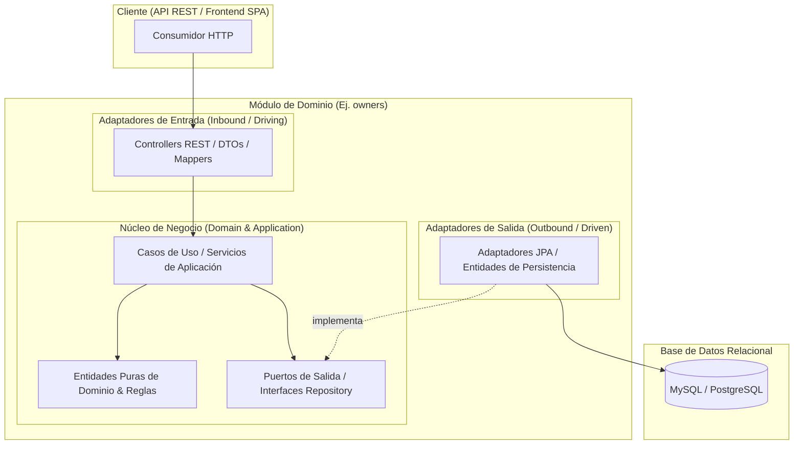

# Arquitectura Target - spring-petclinic Modular

## 1. Arquitectura Objetivo y Límites de Módulos (Bounded Contexts)
Para resolver el acoplamiento del monolito legacy sin incurrir en la complejidad operacional de los microservicios distribuidos, se adopta un **Monolito Modular**. Internamente, cada módulo implementa una **Arquitectura Hexagonal (Puertos y Adaptadores)** para aislar la lógica de negocio de los detalles de infraestructura (Frameworks, Web, JPA).

### Delimitación de Módulos (Dominios):
1. **`owners` (Propietarios y Mascotas):** 
   * *Responsabilidad:* Gestión del ciclo de vida de los dueños, sus datos personales, el catálogo de tipos de mascotas (`PetType`) y el registro de mascotas asociadas.
2. **`visits` (Visitas Clínicas):** 
   * *Responsabilidad:* Gestión del historial médico, control de fechas de atención y registro de visitas clínicas por mascota.
3. **`vets` (Cuerpo Médico):** 
   * *Responsabilidad:* Administración del personal veterinario y sus especialidades médicas asociadas.

---

## 2. Diagrama de Arquitectura Hexagonal por Módulo

---

## 3. Estrategia de Acceso a Datos, Contratos y Gestión de Errores

* **Desacoplamiento de Persistencia:** Las entidades puras del dominio no contendrán anotaciones de JPA (`@Entity`). Se utilizarán *JPA Entities* dedicadas exclusivamente en la capa de infraestructura, mapeándose hacia los modelos de dominio mediante mappers explícitos (ej. MapStruct o mappers manuales).
* **Contratos API REST / DTOs:** Se eliminan por completo los modelos de vista de Thymeleaf. Los adaptadores de entrada expondrán contratos REST puros utilizando DTOs de transferencia independientes para entrada y salida (`*RequestDTO`, `*ResponseDTO`).
* **Gestión Global de Errores:** Se implementará un manejador centralizado mediante `@RestControllerAdvice` que interceptará las excepciones de negocio (como recursos no encontrados o validaciones de dominio) y retornará respuestas JSON estandarizadas con códigos de estado HTTP semánticos (`400 Bad Request`, `404 Not Found`, `422 Unprocessable Entity`).

---

## 4. Decisiones Técnicas y sus Motivos (Architectural Decision Records - ADR)

| Decisión | Alternativas Evaluadas | Motivo de la Selección |
| :--- | :--- | :--- |
| **Monolito Modular** | Microservicios distribuidos | Evita sobrecarga de red y complejidad operativa (Service Discovery, transacciones distribuidas) ideal para el alcance de la prueba. |
| **Arquitectura Hexagonal** | Arquitectura en capas tradicional | Garantiza que el dominio de negocio sea independiente de Spring Data y la web, facilitando pruebas unitarias puras. |
| **Stack Síncrono (Spring WebMVC + JPA)** | Stack Reactivo (WebFlux + R2DBC) | Prioriza la velocidad de entrega y evita la alta complejidad de refactorización reactiva en un entorno relacional bajo un tiempo acotado. |
| **Java 21 & Spring Boot 4.1.2** | Mantener Java 17 / 4.1.0 | Aprovecha características modernas del lenguaje (Records, Pattern Matching) y asegura parches de estabilidad recientes. |
